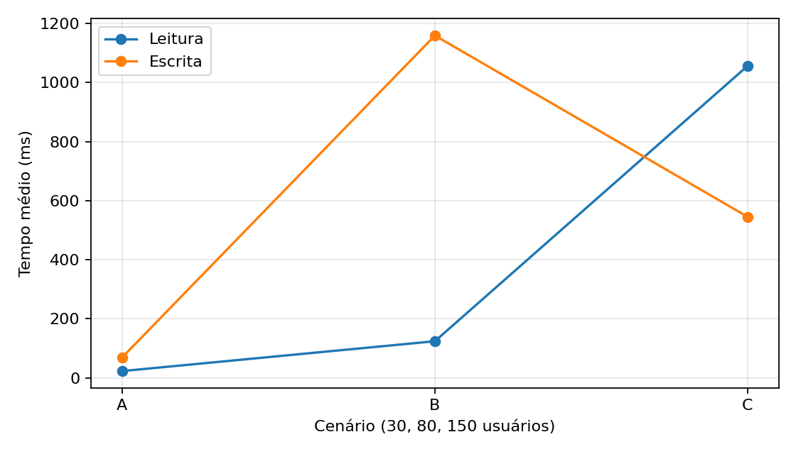
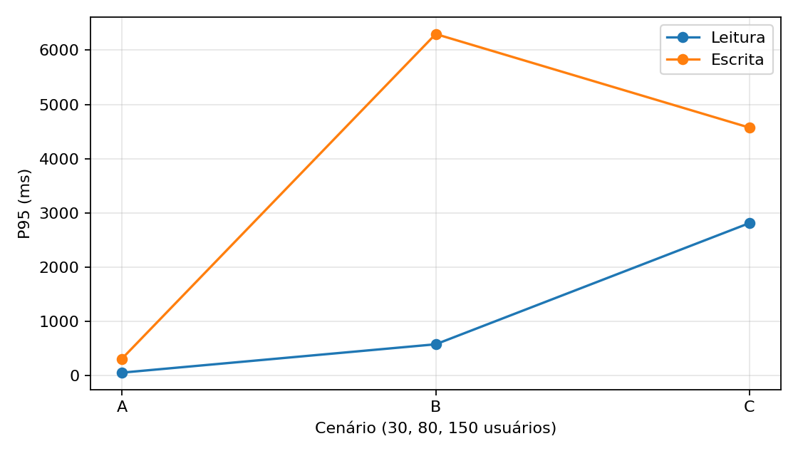
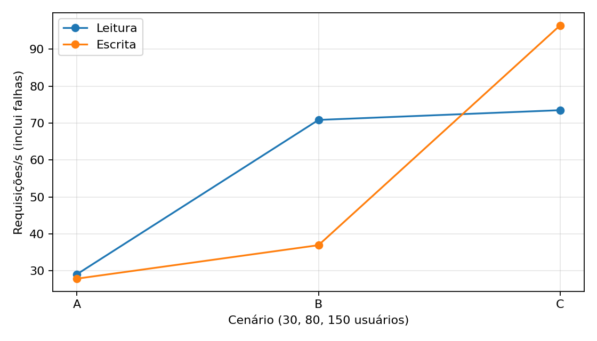
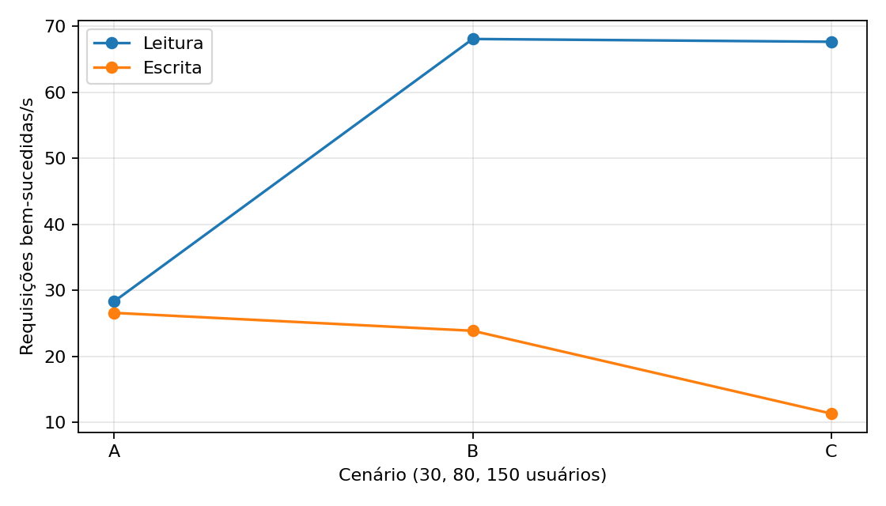
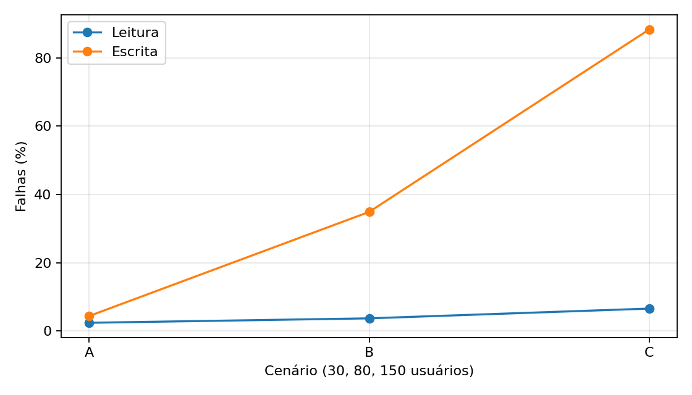
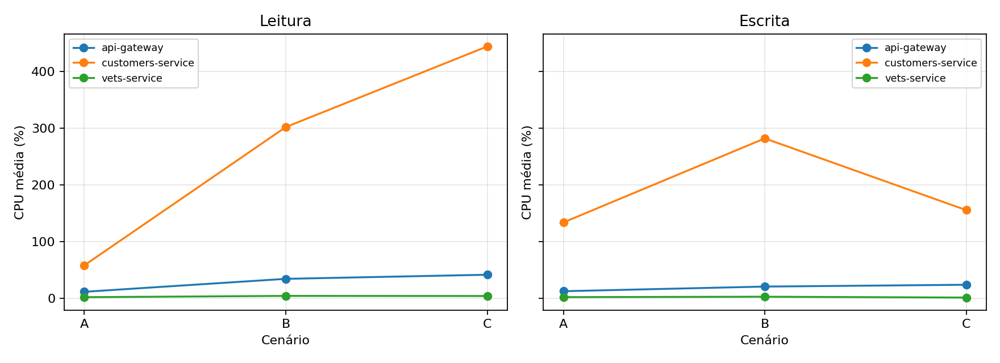
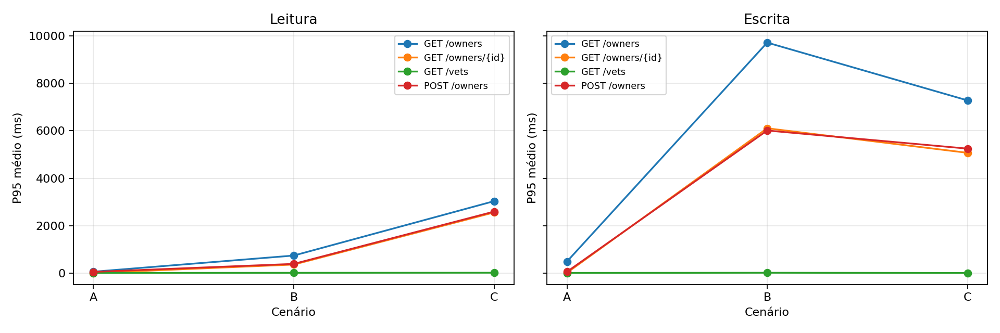

# Trabalho Prático 06 — desempenho do PetClinic com Locust

**Estado desta cópia:** 60 rodadas foram consolidadas em `results/`; confira os CSVs brutos e complete o link do vídeo antes da entrega.

## Objetivo e escopo

Comparar dois perfis de carga em 30, 80 e 150 usuários virtuais, com 10 repetições de cada combinação. Cada rodada dura 6 minutos, incluindo 1 minuto de aquecimento descartado. São 60 rodadas e pelo menos 6 horas de carga, além do tempo de inicialização e análise.

### Versão da aplicação e rotas verificadas

O projeto alvo é [spring-petclinic-microservices](https://github.com/spring-petclinic/spring-petclinic-microservices). O arquivo Compose usado foi obtido no commit [`1d76b00d683e86b62867a6bf59530f8ab301244f`](https://github.com/spring-petclinic/spring-petclinic-microservices/commit/1d76b00d683e86b62867a6bf59530f8ab301244f). A campanha começou em 22/10/2026 e terminou em 23/10/2026. O Compose baixou imagens oficiais `latest` pré-construídas; seus digests exatos estão em [results/environment.md](results/environment.md). Essas imagens podem anteceder o commit do Compose. As rotas foram confirmadas por chamadas HTTP na versão efetivamente executada antes da carga. No código do projeto, o gateway encaminha `/api/customer/**` para customers e `/api/vet/**` para vets, removendo os dois segmentos iniciais. O `OwnerResource` expõe GET e POST em `/owners`, GET em `/owners/{ownerId}`; `VetResource` expõe GET em `/vets`. O POST recebe `firstName`, `lastName`, `address`, `city` e `telephone`.

| Operação do enunciado | Rota usada no gateway | Código fonte |
| --- | --- | --- |
| GET /owners | `GET /api/customer/owners` | [OwnerResource.java](https://github.com/spring-petclinic/spring-petclinic-microservices/blob/1d76b00d683e86b62867a6bf59530f8ab301244f/spring-petclinic-customers-service/src/main/java/org/springframework/samples/petclinic/customers/web/OwnerResource.java) |
| GET /owners/{id} | `GET /api/customer/owners/{id}` | [OwnerResource.java](https://github.com/spring-petclinic/spring-petclinic-microservices/blob/1d76b00d683e86b62867a6bf59530f8ab301244f/spring-petclinic-customers-service/src/main/java/org/springframework/samples/petclinic/customers/web/OwnerResource.java) |
| GET /vets | `GET /api/vet/vets` | [VetResource.java](https://github.com/spring-petclinic/spring-petclinic-microservices/blob/1d76b00d683e86b62867a6bf59530f8ab301244f/spring-petclinic-vets-service/src/main/java/org/springframework/samples/petclinic/vets/web/VetResource.java) |
| POST /owners | `POST /api/customer/owners` | [OwnerRequest.java](https://github.com/spring-petclinic/spring-petclinic-microservices/blob/1d76b00d683e86b62867a6bf59530f8ab301244f/spring-petclinic-customers-service/src/main/java/org/springframework/samples/petclinic/customers/web/OwnerRequest.java) |

O mapeamento dos prefixos está em [application.yml do gateway](https://github.com/spring-petclinic/spring-petclinic-microservices/blob/1d76b00d683e86b62867a6bf59530f8ab301244f/spring-petclinic-api-gateway/src/main/resources/application.yml). O executor faz uma verificação HTTP das quatro operações antes de cada rodada. Após reiniciar o serviço de clientes, GET e POST da verificação aguardam até 90 s para o gateway estabilizar; se as rotas permanecerem indisponíveis, a campanha para antes da carga. O POST usa um nome único e confere se o owner já foi criado antes de repetir uma requisição cuja resposta possa ter se perdido.

## Ambiente para reprodução

- Docker Desktop ou Docker Engine com Docker Compose; reservar memória suficiente para todos os microsserviços. O [README oficial](https://github.com/spring-petclinic/spring-petclinic-microservices#starting-services-locally-with-docker-compose) alerta que a configuração padrão da VM Docker em Windows/macOS pode ser insuficiente.
- Git, Python 3.11+ e acesso à internet para obter dependências e imagens. Java 17 é necessário apenas se optar por compilar o código fonte com `-BuildFromSource`.
- Máquina e rede exclusivas ou sem carga concorrente relevante. Registre CPU, RAM, sistema operacional, versão do Docker, versão do Python e limites de recursos antes da coleta.

No PowerShell, a partir da raiz deste repositório:

```powershell
.\scripts\setup_petclinic.ps1
py -3.11 -m venv .venv
.\.venv\Scripts\python.exe -m pip install -r requirements.txt
```

O primeiro script clona o PetClinic em `petclinic-upstream/`, fixa o commit acima e inicia pelo Docker Compose oficial os serviços necessários (config, discovery, customers, vets, visits e gateway), usando `docker-compose.images.yml` para fixar os digests medidos. Ele falha caso a pasta já exista para evitar sobrescrita. **Nesta coleta**, foram usadas essas imagens pré-construídas, pois o host tinha Java 8, insuficiente para compilar o projeto. Em Linux/macOS, execute `git clone`, `git checkout` no commit e, dentro do clone, `docker compose -f docker-compose.yml -f ../docker-compose.images.yml up -d config-server discovery-server customers-service vets-service visits-service api-gateway`. Se desejar compilar o código fonte em vez de reproduzir as imagens medidas, use `-BuildFromSource` no script PowerShell com Java 17; isso caracteriza outro ambiente experimental.

Confirme `docker compose ps` no clone e aguarde a aplicação em `http://localhost:8080`. O Compose oficial inclui `api-gateway`, `customers-service` e `vets-service`, cujos nomes são usados na coleta de CPU. Anote a descrição do equipamento e versões em `results/environment.md` antes de iniciar. Se usar um Compose alterado, ajuste `CONTAINERS` em `scripts/run_experiments.py` e documente a alteração.

## Perfis e planejamento

| Operação | Leitura | Escrita |
| --- | ---: | ---: |
| GET /owners | 45% | 20% |
| GET /owners/{id} | 35% | 20% |
| GET /vets | 15% | 20% |
| POST /owners | 5% | 40% |

Os pesos em `locustfile.py` somam 100 em cada perfil. A escolha de tarefas é aleatória, portanto a frequência observada se aproxima desses percentuais, sem garantia de igualdade exata. Cada usuário aguarda de 0,5 a 1,5 s entre operações. Todos os perfis usam o mesmo tempo de espera e a mesma taxa de criação de usuários (15/s). As requisições passam pelo gateway, como ocorreria com um cliente externo. O ID de GET individual é escolhido de um conjunto de IDs existentes obtido antes de cada rodada. O POST usa dados únicos para evitar colisões triviais.

| Cenário | Usuários simultâneos | Duração total | Aquecimento descartado | Janela útil | Repetições por perfil |
| --- | ---: | ---: | ---: | ---: | ---: |
| A | 30 | 6 min | 1 min | 5 min | 10 |
| B | 80 | 6 min | 1 min | 5 min | 10 |
| C | 150 | 6 min | 1 min | 5 min | 10 |

O executor embaralha as seis configurações a cada repetição com semente fixa. A rotina final reinicia `customers-service` antes de cada rodada e confirma que o HSQLDB em memória voltou aos 10 proprietários iniciais, tanto no serviço direto quanto pelo gateway. A pré-verificação cria um proprietário adicional. Nesta campanha, 59 rodadas começaram com 11 IDs conhecidos e a primeira (`leitura_A_01`) começou com 12, conforme seus metadados; essa pequena diferença inicial deve ser considerada na comparação. Reiniciar a base evita que os POSTs de uma rodada aumentem o payload de `GET /owners` nas rodadas seguintes. Vets, gateway e discovery permanecem ativos; caches e estado desses serviços não são zerados.

## Execução

Para conferir uma rodada isolada, após subir o PetClinic:

```powershell
.\.venv\Scripts\python.exe scripts\run_experiments.py --single leitura A 1
```

Para as 60 rodadas:

```powershell
.\.venv\Scripts\python.exe scripts\run_experiments.py
```

Cada execução cria `results/raw/<perfil>_<cenário>_<repetição>/` com `requests.csv`, `cpu.csv`, `metadata.json`, `locust.log` e os CSVs nativos do Locust. Se a campanha for interrompida, execute o mesmo comando novamente: rodadas concluídas são preservadas e ignoradas; uma pasta incompleta é movida para `results/interrupted/` com o sufixo `.interrompida_<data>` antes de repetir aquela rodada. A validação exige amostras de CPU dos três serviços até perto do fim dos 6 minutos. Nenhum CSV anterior é apagado. Use `--host URL` se o gateway não estiver em `localhost:8080`.

O `requests.csv` registra cada requisição concluída a partir de 60 s após o início do Locust; o analisador limita a janela a `60 <= tempo < 360` s. Os CSVs nativos do Locust e o log são preservados como diagnóstico, mas incluem o aquecimento e não são usados nos números finais. O `cpu.csv` amostra `docker stats --no-stream` aproximadamente a cada 5 s. O erro de alguns segundos na amostragem de CPU e requisições em voo na borda da janela são limitações do método.

O Locust registra respostas HTTP com erro, JSON inválido e IDs divergentes como falhas. A opção `--exit-code-on-error 0` permite que uma rodada com falhas HTTP termine e seja analisada; falha do processo ainda interrompe a campanha. Uma taxa de falhas elevada é um resultado a investigar, não um motivo para descartar silenciosamente a execução.

Ao concluir as 60 rodadas, o executor gera automaticamente as tabelas, gráficos e respostas no README. Para regerar a análise sem repetir os ensaios:

```powershell
.\.venv\Scripts\python.exe scripts\analyze.py
```

O analisador exige 10 rodadas completas em cada configuração e amostras dos três serviços; não preenche lacunas com zeros. Produz `results/runs.csv`, `results/operations.csv`, `results/operations_summary.csv`, `results/cpu.csv`, `results/summary.csv`, `results/cpu_summary.csv`, `results/analysis.md` e seis PNGs em `results/graphs/`.

## Cálculo das métricas

- **Tempo médio:** média dos tempos de resposta das requisições na janela útil, inclusive falhas com tempo registrado.
- **P95:** posto `ceil(0,95 × N)` dos tempos ordenados em cada rodada.
- **Vazão:** total de requisições concluídas na janela dividido por 300 s, inclusive respostas com erro. A coluna adicional `req/s OK` considera apenas as requisições bem-sucedidas.
- **Total de requisições:** total por rodada; na tabela final, média das 10 contagens, por isso pode ser fracionário.
- **Falhas:** requisições marcadas como falha divididas pelo total da rodada, vezes 100.
- **CPU:** média temporal aproximada das amostras `docker stats` de gateway, customers e vets na janela útil. Um contêiner pode registrar mais de 100% se usar mais de um núcleo.

Primeiro calculam-se as métricas por rodada; depois, cada valor na tabela principal é a média aritmética das 10 rodadas. O P95 da tabela é, portanto, a média de dez P95, não o P95 combinado de todas as requisições. `results/operations.csv` permite comparar a degradação por operação. O limite de memória/CPU do Docker, a coleta por uma única máquina geradora de carga, o cache de vets, o crescimento do banco e outros processos do host podem influenciar os resultados.

## Resultados, análise e conclusões

<!-- ANALYSIS_START -->
### Resultados medidos

Valores são médias aritméticas das 10 repetições por configuração. Cada rodada tem 6 min, dos quais os primeiros 60 s foram descartados; vazão usa 300 s como denominador. `req/s` inclui respostas com erro; `req/s OK` conta apenas respostas bem-sucedidas. P95 é calculado em cada rodada pelo posto mais próximo e depois promediado.

| Perfil | Cenário | Usuários | Média ms | P95 ms | req/s | req/s OK | Req. | Falhas % |
| --- | --- | --- | --- | --- | --- | --- | --- | --- |
| leitura | A | 30 | 23.14 | 56.63 | 29.06 | 28.35 | 8718.0 | 2.43 |
| leitura | B | 80 | 124.24 | 579.12 | 70.86 | 68.07 | 21257.3 | 3.73 |
| leitura | C | 150 | 1056.64 | 2812.97 | 73.49 | 67.65 | 22047.8 | 6.59 |
| escrita | A | 30 | 69.29 | 312.45 | 27.86 | 26.61 | 8357.1 | 4.41 |
| escrita | B | 80 | 1159.26 | 6296.72 | 36.93 | 23.90 | 11078.2 | 34.88 |
| escrita | C | 150 | 545.41 | 4571.64 | 96.45 | 11.37 | 28934.4 | 88.26 |

| Perfil | Cenário | Gateway % | Customers % | Vets % |
| --- | --- | --- | --- | --- |
| leitura | A | 11.43 | 58.11 | 1.98 |
| leitura | B | 34.27 | 301.69 | 4.21 |
| leitura | C | 41.50 | 443.73 | 4.00 |
| escrita | A | 12.47 | 133.66 | 2.05 |
| escrita | B | 20.63 | 281.71 | 2.77 |
| escrita | C | 23.83 | 155.38 | 1.29 |

#### Operações

| Perfil | Cenário | Operação | Peso observado % | Média ms | P95 ms | Falhas % |
| --- | --- | --- | --- | --- | --- | --- |
| leitura | A | GET /owners | 45.21 | 38.35 | 62.80 | 2.43 |
| leitura | A | GET /owners/{id} | 34.92 | 7.00 | 9.55 | 2.46 |
| leitura | A | GET /vets | 14.93 | 7.53 | 10.47 | 2.44 |
| leitura | A | POST /owners | 4.94 | 45.05 | 55.72 | 2.25 |
| leitura | B | GET /owners | 45.14 | 209.06 | 743.04 | 3.75 |
| leitura | B | GET /owners/{id} | 34.84 | 68.01 | 363.48 | 3.80 |
| leitura | B | GET /vets | 14.99 | 9.18 | 16.23 | 3.46 |
| leitura | B | POST /owners | 5.02 | 97.25 | 391.42 | 3.87 |
| leitura | C | GET /owners | 44.92 | 1374.57 | 3033.20 | 6.61 |
| leitura | C | GET /owners/{id} | 35.10 | 1091.55 | 2557.16 | 6.52 |
| leitura | C | GET /vets | 15.07 | 9.93 | 19.60 | 6.64 |
| leitura | C | POST /owners | 4.91 | 1110.67 | 2593.78 | 6.75 |
| escrita | A | GET /owners | 20.07 | 238.60 | 489.94 | 4.57 |
| escrita | A | GET /owners/{id} | 19.75 | 10.19 | 16.39 | 4.29 |
| escrita | A | GET /vets | 20.07 | 7.74 | 11.79 | 4.30 |
| escrita | A | POST /owners | 40.11 | 44.70 | 59.85 | 4.45 |
| escrita | B | GET /owners | 19.98 | 2143.39 | 9710.77 | 38.47 |
| escrita | B | GET /owners/{id} | 20.21 | 1207.56 | 6102.54 | 34.33 |
| escrita | B | GET /vets | 20.04 | 8.84 | 18.55 | 33.36 |
| escrita | B | POST /owners | 39.77 | 1220.92 | 6008.46 | 34.12 |
| escrita | C | GET /owners | 19.94 | 775.11 | 7277.13 | 89.93 |
| escrita | C | GET /owners/{id} | 20.05 | 616.25 | 5069.28 | 88.42 |
| escrita | C | GET /vets | 19.92 | 5.09 | 9.67 | 86.29 |
| escrita | C | POST /owners | 40.09 | 664.07 | 5246.24 | 88.33 |









### Respostas às questões

1. **Usuários e tempo de resposta:** em leitura, a média subiu de 23.14 ms (A) para 124.24 ms (B) e 1056.64 ms (C). Em escrita, foi 69.29 ms (A), 1159.26 ms (B) e 545.41 ms (C). A queda aparente de B para C em escrita ocorre junto de 88.26% de falhas; respostas de erro rápidas reduzem a média, sem indicar melhora do serviço.
2. **Maior vazão:** leitura, pela média de req/s dos três cenários (57.80 em leitura; 53.74 em escrita). Em requisições bem-sucedidas/s, leitura também liderou (54.69 contra 20.63). O pico bruto de 96.45 req/s em escrita C contém muitas falhas; só 11.37 req/s tiveram sucesso.
3. **Maior degradação:** GET /owners no perfil escrita, com aumento de 6787.19 ms no P95 médio de A para C (14.85×). A comparação completa por operação está em `results/operations.csv`.
4. **CPU:** de A para C, api-gateway: 11.43→41.50% em leitura e 12.47→23.83% em escrita; customers-service: 58.11→443.73% em leitura e 133.66→155.38% em escrita; vets-service: 1.98→4.00% em leitura e 2.05→1.29% em escrita. CPU do Docker pode superar 100% em múltiplos núcleos; é porcentagem de núcleo, não fração do limite da máquina. A CPU de customers em escrita C ficou abaixo de B ao mesmo tempo que a taxa de falhas aumentou muito; isso não demonstra ganho de eficiência.
5. **Maior taxa de falhas:** escrita / cenário C, 88.26%.

### Conclusões

Nesta campanha, **leitura** teve a maior vazão média e **leitura** a maior vazão bem-sucedida. A maior degradação do P95 entre A e C foi GET /owners em escrita, com aumento de 6787.19 ms. A maior taxa de falhas foi escrita / cenário C, 88.26%. Em escrita C, apenas 11.37 das 96.45 req/s médias tiveram sucesso. Não se deve interpretar o menor tempo médio desse cenário como melhora do atendimento.

Os logs do Locust registram HTTP 405 em GETs e HTTP 503 em POSTs. O gateway também registrou períodos sem instâncias disponíveis de `customers-service`; isso sustenta parte dos 503, mas os registros atuais não permitem atribuir com segurança todos os 405 a uma causa única. Portanto, as conclusões sobre degradação descrevem a **pilha implantada neste ambiente**, não isolam o desempenho interno de cada microsserviço. Os tempos de resposta incluem falhas; a vazão bem-sucedida ajuda a distinguir rapidez de erro de capacidade útil.

Os CSVs de cada execução em `results/raw/` são a evidência bruta. Os números refletem este ambiente e esta ordem de rodadas; criação de proprietários aumenta o tamanho da base dentro de cada rodada. Variações entre repetições e serviços concorrentes no host também limitam a generalização.

<!-- ANALYSIS_END -->

## Evidências

| Item | Estado |
| --- | --- |
| CSVs das 60 rodadas | Disponíveis em `results/raw/` |
| Tabelas e gráficos | Disponíveis em `results/` |
| Descrição do ambiente em `results/environment.md` | Disponível em `results/environment.md` |
| Repositório GitHub público com este conteúdo | [trabalho-6-locust-petclinic](https://github.com/NoletoS/trabalho-6-locust-petclinic) |

O roteiro de gravação está em `scripts/video_checklist.md`. Antes da entrega no SIGAA em **23/10/2026**, confirme que os 60 diretórios de rodada, a análise, o vídeo acessível e o link público do repositório estão presentes. O único item a postar no SIGAA é o link do repositório.
